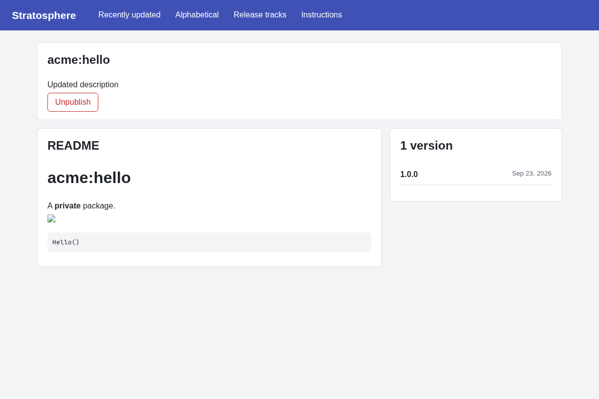

# Stratosphere
Stratosphere is a private package server for Meteor.
So this is like Atmosphere on your own servers, with private packages.

Besides your own packages, Stratosphere will also give you access to all packages on Atmosphere.

At any time you can switch between package servers by setting an environment variable.



Stratosphere runs on Meteor 3 with a SolidJS front-end, and works with current versions of meteor-tool.

## Installation

To install Stratosphere you'll need to create and configure a meteor developer app.
Follow these 3 steps to the letter:

### 1) Create a Meteor developer app
First create an app that can use the meteor developer account services:
[https://www.meteor.com/account-settings/apps](https://www.meteor.com/account-settings/apps)

**IMPORTANT:** Make sure to set the following redirect urls:
`http://[your package server url]/_oauth/meteor-developer?close` (used by meteor-tool) and `http://[your package server url]/_oauth/meteor-developer` (used by the web interface).
So if your package server runs at localhost:3000, set: `http://localhost:3000/_oauth/meteor-developer?close` and `http://localhost:3000/_oauth/meteor-developer`

### 2) Create settings.json file
Copy the settings.json.template file to settings.json
Fill in the app id (`meteorDeveloperAccount.clientId`) and app secret (`meteorDeveloperAccount.secret`) from the previous step and the url the package server will run on (`public.url`)
Also fill in if people need to login by setting `public.loginRequired`. If you enable logins, you need to add at least one superUser. This is the username of your meteor-developer account.

**IMPORTANT:** meteor-tool only tries to authenticate when publishing data. `loginRequired` has no effect on who can see your packages, only on who can publish!

### 3) Run the app
This is a Meteor project, so you can deploy and run it the same way as any other Meteor project.
You need to tell meteor it needs to use the settings.json file with the --settings option:

```
meteor npm install
meteor --settings settings.json
```

## Usage
To publish and sync with Stratosphere, you have to set the package server URL to your stratosphere URL.
This can be achieved by setting the environment variable: METEOR_PACKAGE_SERVER_URL to your package server url.

**IMPORTANT:** You can not immediately publish stand-alone packages. Meteor first needs to create and fill up a new package database file.
This is automatically done for you when you try to run an existing meteor project with the environment variable set.
First time syncing can take long (up to 10min), since it needs to import all package data from the official package repo and do some processing on them.

Meteor splits the package database and package files according to this URL, so you should be able to switch package servers back and forth by changing this variable.

## Settings
* upstreamURL: The URL to the official package server. Default value is packages.meteor.com, you probably don't want to change this.
* directories.uploads: Directory where uploaded package files are stored and downloaded from, must be writable by the meteor process. Relative paths are resolved against the app (or bundle) root.
* public.loginRequired: Whether a login is required. This only affects publishing of packages, everyone can still see all packages!
* public.url: The url of the package server
* superUsers: Which user accounts (meteor developer account names) have full access to user management. This has only effect if `public.loginRequired` is enabled.
* meteorDeveloperAccount.clientId: Client id of your meteor accounts app, MUST BE FILLED IN BY YOU
* meteorDeveloperAccount.secret: Secret key of your meteor accounts app, MUST BE FILLED IN BY YOU
* enableS3Sync / s3Sync: Sync the uploads directory with an S3 bucket, e.g. to run multiple instances. Requires the [AWS CLI](https://aws.amazon.com/cli/) (`aws`) on the server.
* enableIpWhitelisting / ipWhitelist / ipWhitelistAuthKey: Only allow HTTP requests from the listed IP addresses and CIDR ranges. Additional IPs can be whitelisted at runtime by sending a request to `/whitelist` with the `apikey` header set to `ipWhitelistAuthKey` (through a proxy that sets `x-forwarded-for`).

If `public.loginRequired` is set to true, you need at least one superUser. SuperUsers can add and manage other users in the Stratosphere GUI.
SuperUsers themselves can only be added and removed by changing the setting in the settings file.

## Security remarks
Note that there is no mechanism to protect your package files from being viewed by everyone.
IP whitelisting only covers HTTP requests (pages and package files), not the DDP connection meteor-tool uses to sync and publish.
This means that to protect your Stratosphere install, you probably want to run it inside a firewall protected part of your organization.

## Development

```
meteor npm install
cp settings.json.template settings.json
meteor npm start
meteor npm test
```

The server code lives in `imports/server`, the SolidJS front-end in `imports/ui`. The methods in `imports/server/methods/meteortool.js` and `syncNewPackageData` in `imports/server/sync.js` are the API meteor-tool talks to (see `tools/packaging/package-client.js` in the Meteor repository), so keep them compatible.

## Contribute
We welcome contributions.

Here are some other ideas:
- Add Tests
- Look into the 'XXX'-es inside the code, these serve as TODOS
- Improve security (e.g. verify hashes)
- Whatever front-end functionality that might be useful
